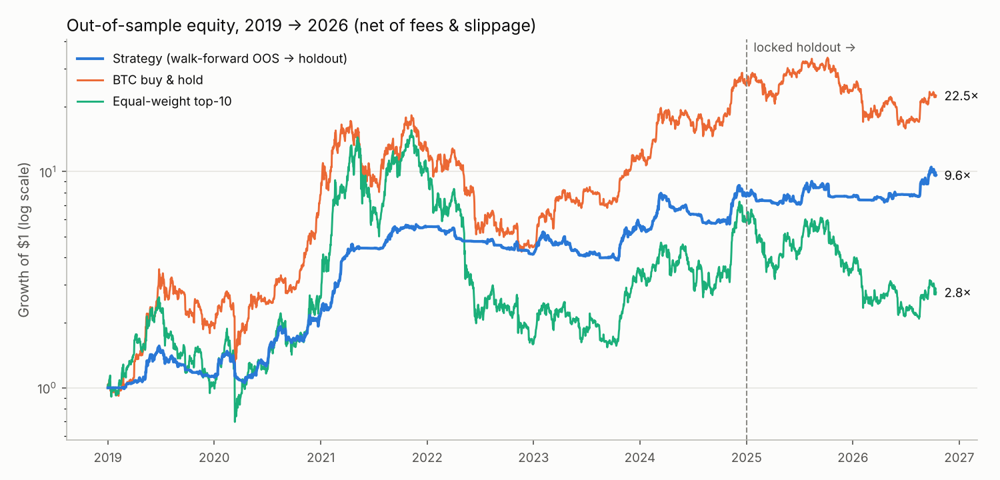
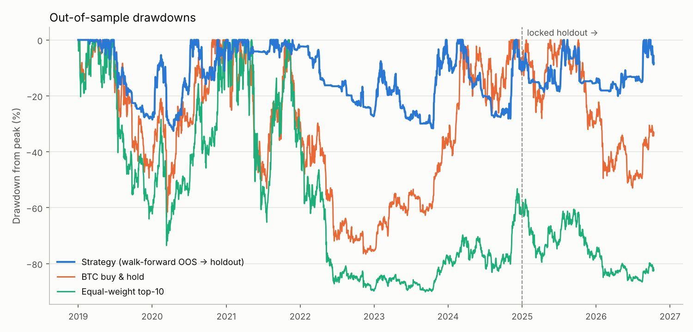

# cryptobot — volatility-targeted crypto trend rotation

An asset-agnostic, long-only spot strategy for crypto. It rotates into the
strongest-trending liquid coins, sizes positions by volatility, and moves to
cash (USDT) when the market trends down. It was built under a pre-registered
validation protocol ([`PROTOCOL.md`](PROTOCOL.md), committed before any
results were seen) and comes with a live/paper engine that is proven to make
identical decisions to the backtest.




## Verdict

**What the evidence supports.** The edge is real, survives realistic costs,
and cuts drawdowns by more than half compared with holding crypto. Across
about 7.8 years of out-of-sample data it turned $1 into 9.6× with a worst
drawdown of −33%. BTC buy-and-hold made 22.5× over the same window but went
through a −77% drawdown, and an equal-weight top-10 basket made 2.8× through
−90%. In the 21-month locked holdout it returned **+25%** while BTC returned
−11% and the alt basket −53%.

**What it is not.** It does not beat BTC buy-and-hold on raw return in a
roaring bull market: it trades upside for survival. It did **not** pass every
benchmark I set for it (scorecard below). Its returns over the most recent 21
months were modest (13.5% a year, Sharpe 0.67), and they are sensitive to
executing promptly after the daily close.

**Recommendation.** Before risking capital, run the paper forward test (already
started, see below) for at least 90 days. Go live only if
`forward_report.py` says `continue`, start with a small allocation, and obey
the kill-switch rules.

## Scorecard against the pre-registered benchmarks

Out-of-sample periods: walk-forward 2019-01-01 → 2024-12-31 (each year traded
with parameters chosen only on earlier data), and the locked holdout
2025-01-01 → 2026-10-13, which was run once with a config frozen and pushed
beforehand (commit `f2febb8`, sha256 `c8df95f…`). All figures are net of a
0.10% fee plus liquidity-scaled slippage on every trade.

| # | Benchmark | Walk-forward OOS | Holdout | Result |
| --- | --- | --- | --- | --- |
| B1 | Sharpe ≥ 1.0 and > BTC | **1.40** vs BTC 1.15 | 0.67 vs BTC 0.06 | WF ✅ / holdout ❌ (<1.0, but ≫ BTC) |
| B2 | MaxDD ≤ ½ BTC's and ≤ 40% | **−32.6%** vs BTC −76.6% | **−20.1%** vs BTC −53.0% | ✅ ✅ |
| B3 | Calmar ≥ 1 and > BTC | **1.24** vs 0.93 | 0.67 vs −0.12 | WF ✅ / holdout ❌ (<1, but > BTC) |
| B4 | Deflated Sharpe ≥ 0.95 (324 trials counted) | 0.944 | – | ❌ (narrow) |
| B5 | Prob. of backtest overfitting ≤ 0.25 | **0.14** | – | ✅ |
| B6 | Sharpe at 2× costs ≥ 0.75 | **1.31** | 0.54 | WF ✅ / holdout ❌ |
| B7 | Sharpe with fills one day late ≥ 0.75 | **1.14** | 0.41 | WF ✅ / holdout ❌ |
| B8 | Grid neighbours ≥ 0.7× chosen Sharpe ≥ 80% | **100%** | – | ✅ |
| B9 | Holdout Sharpe ≥ ½ WF and > 0 | – | 0.67 vs 0.70 needed | ❌ (narrow) |
| B10 | Live engine = backtest | – | 651/651 days identical (max weight diff 0.0); paper NAV tracks the simulator to 0.95% a year | ✅ |

Supporting detail (`reports/`):

* **Walk-forward by year.** Returns were +12% (2019), +95% (2020), +154%
  (2021), −25% (2022), +35% (2023), +38% (2024). BTC returned −64% in 2022.
* **Bootstrap.** P(Sharpe > 0) = 99.5%. The 5th-percentile CAGR is +13%.
* **Robustness** (`robustness.json`, frozen config, 2019 → now; 2019–2024 is
  in-sample here):
  * Rebalance weekday phase: Sharpe 1.24–1.52 across the 7 phases. The
    phase in use is the best of them, so expect about 1.35 rather than 1.52.
  * 30 random half-universes: median Sharpe 1.27 (5th–95th percentile
    1.05–1.42).
  * Account size: Sharpe 1.53 at $10k and 1.38 at $10M.
* **Research history, kept on purpose.** v1 (daily selection) failed on
  drawdown at −58%. v2 (weekly entries with daily exits) failed at −45%.
  v3 (drawdown-constrained selection) is the frozen version. Every
  configuration ever evaluated is counted in the Deflated Sharpe.

## How it works

Everything is computed daily after the 00:00 UTC candle close.

1. **Universe.** Take the top 30 USDT pairs by 30-day median dollar volume,
   among coins with at least 200 days of history. Stablecoins and leveraged
   tokens are excluded. The universe is chosen point-in-time, and delisted
   coins (LUNA, FTT, …) are included in the data, so there is no survivorship
   bias.
2. **Trend score.** Average `tanh(z)` over 10/20/40/80-day log-returns, each
   scaled by its expected volatility. The result lies in [−1, 1].
3. **Selection.** Every 7th day, pick the top 8 coins with a positive trend.
   A coin is dropped on the first day its trend turns non-positive. New
   entries happen only on rebalance days, which prevents chasing one-day
   pumps.
4. **Sizing.** Weight each pick by trend strength divided by volatility.
   Scale the portfolio to a 35% annualised volatility target (cap: 100%
   gross, no leverage), with at most 30% in any one coin.
5. **Regime filter.** Exposure is multiplied by `clip(0.5 + BTC trend, 0, 1)`.
   When BTC is in a strong downtrend the bot goes fully to cash.
6. **Execution.** A coin is traded only when its weight is more than 5
   percentage points off target; exits always execute. Sells go before buys.
   Average exposure is about 27–30% (median 26%; it is near 0% in bear markets), and annual turnover is 16–19×.

The economic basis is well documented: time-series momentum and
cross-sectional momentum in crypto (Liu & Tsyvinski 2021; Liu, Tsyvinski &
Wu 2022) and volatility-managed portfolios (Moreira & Muir 2017).

## Quick start

```bash
cd cryptobot
pip install -r requirements.txt
python scripts/download_data.py            # ~45 min first time: 674 symbols, 2017→today
python -m pytest -q tests                  # incl. look-ahead (truncation-invariance) test
python scripts/run_research.py wf          # walk-forward + all diagnostics (~1 min)
python scripts/run_research.py holdout     # frozen-config holdout
python scripts/replay_parity.py            # B10 live/backtest parity (~9 min)
python scripts/robustness.py               # phase / half-universe / account-size tests
python scripts/make_charts.py
```

## Forward testing (started 2026-10-14)

Two paper ledgers are already running from the 2026-10-13 bar:

* `reports/paper/binance-archive/` uses the exact data source of the
  backtest.
* `reports/paper/okx/` uses real OKX prices through the exchange API. Its
  picks matched the backtest's on 7 of 8 coins; the eighth, OKB, is OKX's own
  exchange token.

To keep them going:

* **Automatically.** `.github/workflows/cryptobot-forward-test.yml` runs
  daily at 03:17 UTC and commits the ledger. GitHub runs scheduled workflows
  only from the default branch, so it starts once this branch is merged into
  `master`. It is paper-only and uses no API keys.
* **Manually or by cron.** Run `python scripts/paper_trade.py --exchange okx`
  (or `kucoin`, `binance`, etc.) once a day after 00:05 UTC.
* **Checking progress.** `python scripts/forward_report.py` compares the
  forward NAV with the bootstrap band implied by the out-of-sample record and
  evaluates the kill switches.

## Going live with real funds

```bash
export API_KEY=... API_SECRET=...              # spot-trading permission only, NO withdrawals
export CRYPTOBOT_LIVE=I_UNDERSTAND_THE_RISK
python scripts/paper_trade.py --exchange binance --dry   # inspect targets first
python scripts/paper_trade.py --exchange binance --live
```

Schedule it daily at 00:05 UTC. The edge degrades when execution is delayed
(B7), so do not run it late. Use a dedicated sub-account, start at 10–25% of
the capital you intend to commit, and scale up only after 90+ days of live
results inside the expected band.

**Kill-switch rules (stop and re-validate):**

1. NAV falls more than 45% from its peak (1.4× the worst out-of-sample
   drawdown).
2. After 90 or more days, the forward return falls below the 2.5th percentile
   of the backtest's expectation band.
3. Realised costs per trade exceed twice the model (check the fills against
   `trades.csv`).

`forward_report.py` evaluates rules 1 and 2 automatically.

**Maintenance.** Once a year, re-run `download_data.py` and
`run_research.py wf` with `DEV_END` moved forward one year. If the selected
config changes, run the new one in paper first. Do not re-tune more often:
that is how overfitting creeps back in.

## Asset-specific mode: how to tune it, and when to pick an asset

The portfolio strategy above is asset-agnostic and is the recommended mode.
For running the same trend engine on a single coin, use:

```bash
python scripts/tune_asset.py SOLUSDT       # writes configs/SOLUSDT.json only if it qualifies
python scripts/paper_trade.py --asset SOLUSDT --exchange okx
```

**How to pick an asset.** A coin is tradable in single-asset mode only if it
passes every gate:

| Gate | Requirement | Why |
| --- | --- | --- |
| S1 | ≥ 730 days of history and ≥ $20M 30-day median daily volume | enough regimes to validate; low slippage |
| S2 | Walk-forward OOS Sharpe ≥ 0.8 | real edge after costs |
| S3 | Beats the coin's own buy-and-hold Sharpe | otherwise just hold it |
| S4 | MaxDD ≤ 60% of buy-and-hold's | the point of trend following |
| S5 | Positive in ≥ 60% of walk-forward years | not one lucky year |
| S6 | Holdout Sharpe > 0 and ≥ ½ walk-forward Sharpe | generalises to data it never saw |

A variance ratio above 1 (`variance_ratio_20d` in the output) indicates
trending behaviour, but it is informational only, not a gate.

**How it tunes.** The tuner tests 3 lookback ensembles × 3 volatility
targets. It selects the config using the plateau rule (mean Sharpe of a
config and its neighbours) on a yearly walk-forward, and never touches
holdout data during selection.

**When to (re)pick.** Re-run `tune_asset.py` monthly for each candidate.
Start trading a coin only when it newly passes all gates, and stop when it
fails S2 or S6 on a re-run. Never pick a coin because of a recent rally:
S1–S6 already ask the only questions that matter.

**Current result (2026-10-14).** None of BTC, ETH, SOL, BNB, XRP, DOGE, ADA,
LINK or TRX qualifies (`reports/tune/`). Several pass S1–S5 in walk-forward
(e.g. BTC: Sharpe 1.42, MaxDD −25% vs −77% for holding it). All fail S6:
single-coin trend following did not work in 2025–26, while the diversified
rotation did. **Use the portfolio mode.**

## Limitations, stated plainly

* **No backtest proves future profits.** The forward record started on
  2026-10-14. Until it is months long, the evidence is out-of-sample history,
  not live P&L.
* **Single venue.** The backtest data are Binance spot. Other venues differ in
  listings and liquidity; the OKX check showed 7 of 8 picks in common.
* **Cash earns 0%.** Holding USDT in a lending or yield product would add
  return, along with counterparty risk.
* **Fills are modelled at the daily close plus slippage.** A 1-day delay
  costs about 0.25 Sharpe (B7).
* **Not financial advice.** Exchange, custody, regulatory and tax risk are
  outside this model; Australian residents should note that disposals are CGT
  events.

## Layout

```
cryptobot/
  data.py        Binance archive download (incl. delisted), point-in-time panel
  strategy.py    signals, selection, sizing  <- the only place trading logic lives
  backtest.py    daily simulator: drift, no-trade band, fees+slippage, delisting haircut
  metrics.py     Sharpe/Calmar/..., PSR, Deflated Sharpe, PBO (CSCV), block bootstrap
  research.py    grid, walk-forward helpers, benchmarks
  live.py        ccxt market data, order planning, paper account, live broker
scripts/         download, research, parity, robustness, tuning, paper/live trading, reports
reports/         every result quoted above (JSON/CSV/PNG), incl. failed iterations
frozen_config.json   the configuration being traded (hash-checked)
PROTOCOL.md      pre-registered validation protocol and benchmarks
```
