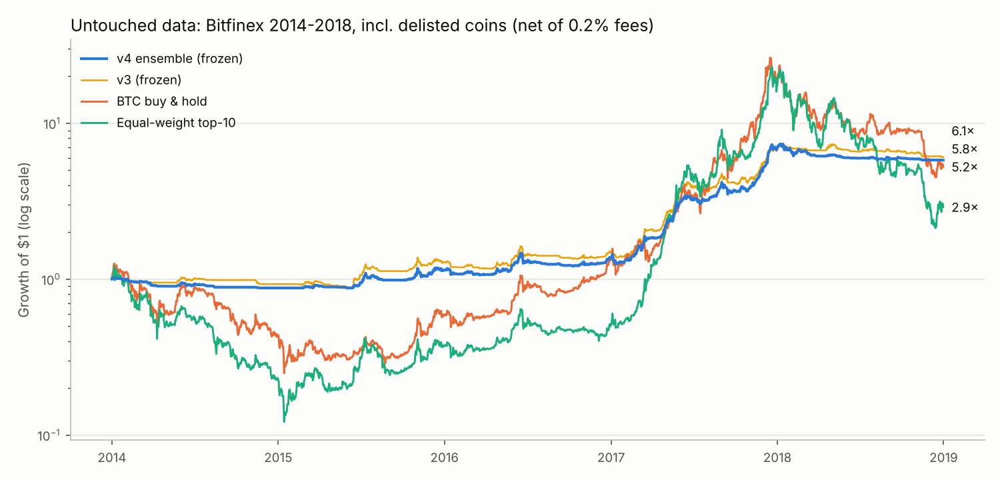
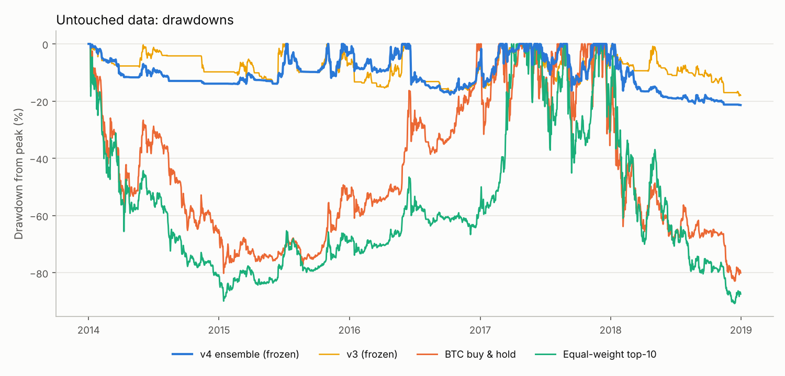
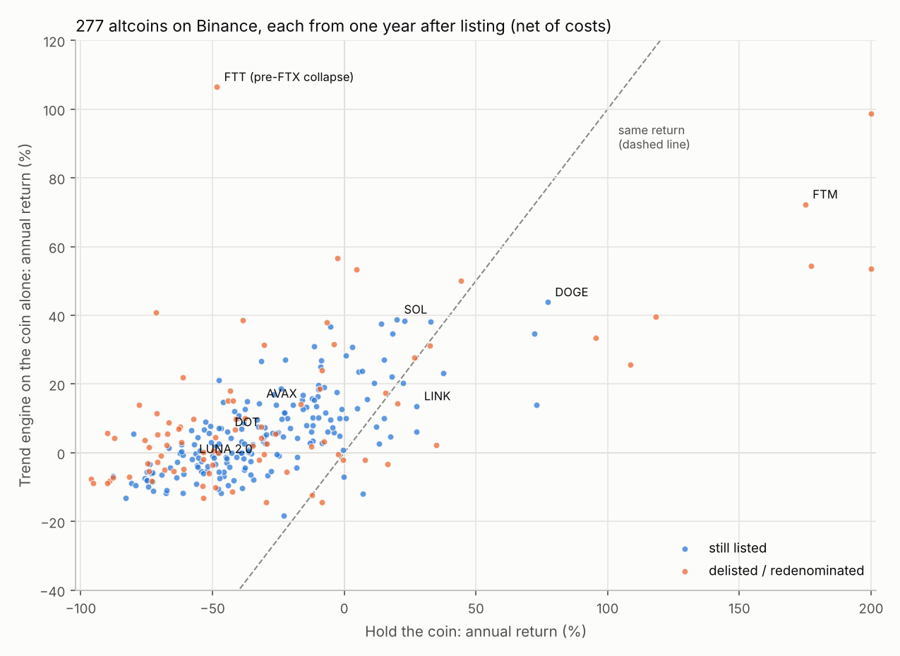

# cryptobot — trend-following crypto rotation (v4 ensemble)

An asset-agnostic, long-only spot strategy for crypto. Every day after the
00:00 UTC close it ranks the most liquid coins by trend strength, holds the
strongest uptrends sized by volatility, and moves to cash (USDT) when the
market trends down.

The current version, **v4**, came out of a full audit of the first version
([`AUDIT.md`](AUDIT.md)). It has no tuned parameters: it averages 27 signal
configurations on 7 staggered rebalance calendars. It was frozen, then tested
once on data nobody had looked at, under a pre-registered protocol
([`PROTOCOL_v2.md`](PROTOCOL_v2.md)).




## Verdict

**What the evidence supports.** The strategy has a statistically solid,
cost-robust edge, and it cuts drawdowns to between a quarter and a half of
holding crypto.

* **Untouched data.** On a different exchange (Bitfinex, 2014-2018, delisted
  coins included) it made **+42% a year at a −21% worst drawdown**. BTC made
  +39% a year at −83%. It passed all six pre-registered criteria.
* **Combined record.** Over all records (12.8 years, 2014 → 2026) it compounds
  at 32% a year with Sharpe 1.40 and a worst drawdown of −32%.

**What it is not.**

* **It doesn't beat BTC in roaring bull markets.** In 2017 it made +407%
  while BTC made +1,325%. It trades upside for survival.
* **It earns little in choppy markets.** In 2025-26 it made only +7.7% in
  21 months (BTC −11%, alts −53%).
* **The live record is still short.** The forward test started on
  2026-10-14, so there is little live evidence yet.

**Recommendation.** Paper-trade it for 90 days. The ledgers are already
running, and the daily job keeps them going once merged. Then go live with
10–25% of the intended capital if `forward_report.py` says `continue`, and
scale up only while results stay inside the expected band.

## Evidence

| Tier | Data | v4 Sharpe | v4 CAGR | v4 MaxDD | BTC Sharpe / MaxDD | Status |
| --- | --- | --- | --- | --- | --- | --- |
| **Fresh (primary test)** | Bitfinex 2014-2018, 113 pairs incl. delisted, 0.2% fees | **1.72** | **42.1%** | **−21.4%** | 0.82 / −82.9% | untouched, run once, **all 6 criteria passed** |
| Development | Binance 2019-2024 | 1.42 | 33.9% | −31.7% | 1.15 / −76.6% | in-sample at the design level |
| Holdout | Binance 2025-01 → 2026-10 | 0.31 | 4.2% | −23.5% | 0.06 / −53.0% | contaminated (seen before v4 existed), not used for decisions |
| Forward | live paper ledgers | – | – | – | – | started 2026-10-14 |

Pre-registered fresh-data criteria (`reports/v4_fresh_bitfinex.json`), all ✅:

| # | Criterion | Result |
| --- | --- | --- |
| F1 | Probabilistic Sharpe vs 0 ≥ 0.95 | 0.9999 |
| F2 | Sharpe ≥ BTC buy-and-hold | 1.72 vs 0.82 |
| F3 | MaxDD ≤ ½ of BTC's | −21.4% vs −82.9% |
| F4 | Calmar > BTC's | 1.97 vs 0.47 |
| F5 | Sharpe at 2× costs ≥ 0.75× base | 1.61 (94%) |
| F6 | Consistent with the development record (≥ 5th pct) | 66th percentile |

Other checks:

* **Cost and timing robustness.** Cost drag is 0.67% a year at 3.9× annual
  turnover. Sharpe stays at 1.40–1.43 whether fills happen at the close or
  1, 4 or 12 hours later (hourly data, `reports/v4_exec_delay.json`).
* **Liquidity.** It still passes all six criteria when positions are capped
  at 10% or even 2% of each coin's daily volume
  (`reports/v4_capacity_liquidity.json`).
* **Live engine = backtest.** On all 651 holdout days, signals matched to
  7e-15. Paper-account NAV tracks the simulator to 0.06% a year
  (`reports/v4_parity.json`).
* **No single lucky setting.** The ensemble beats its median member (1.42 vs
  1.34). On random half-universes, Sharpe ranges 1.28–1.75.
* **Independent review.** A separate review of the live engine found 3
  high-severity defects (section 2b of [`AUDIT.md`](AUDIT.md)). All are fixed
  and covered by tests.

## Risk profiles: the one dial

Everything is frozen except the portfolio volatility target, which you choose
with `--risk`. Sharpe barely changes across profiles; return and drawdown
scale together.

| Profile | Vol target | Fresh 2014-18: CAGR / MaxDD | Dev 2019-24: CAGR / MaxDD | Holdout 2025-26: CAGR / MaxDD | Kill switch |
| --- | --- | --- | --- | --- | --- |
| conservative | 20% | 26% / −13% | 16% / −16% | 1% / −12% | −20% |
| **balanced (default, validated)** | **35%** | **42% / −21%** | **34% / −32%** | **4% / −24%** | **−45%** |
| growth | 50% | 54% / −36% | 49% / −42% | 0% / −29% | −60% |
| aggressive | 75% | 69% / −38% | 62% / −56% | 3% / −36% | −80% |

`python scripts/risk_profiles.py` produces these (`reports/v4_profiles.json`)
and each profile's daily record, which `forward_report.py` and the live
monitor use. The kill switch is 1.4× the profile's worst drawdown in any
record, rounded to 5%. More risk paid only in trending markets. In the choppy
2025-26 holdout, growth made 0.2% a year against balanced's 4.2%, with a
deeper drawdown.

Only "balanced" was the pre-registered configuration; the other rows are
informational. Choose the drawdown you can sit through without switching the
bot off. Abandoning it mid-drawdown is the most common way a sound strategy
loses money.

## How it works

Everything is computed daily after the 00:00 UTC candle close. Per ensemble
member:

1. **Universe.** The top N coins (N = 15 / 30 / 50) by 30-day median dollar
   volume, among coins with at least 200 days of history.
   * Stablecoins, leveraged tokens and tokenised stocks are excluded.
   * Delisted coins are in the data, so there is no survivorship bias.
2. **Trend score.** The average of `tanh(z)` over four lookback horizons,
   where z is the log-return scaled by its expected volatility.
   * Fast set: 10/20/40/80 days. Medium: 20-160. Slow: 40-320.
3. **Selection.** On the member's weekly rebalance day, take the top K
   (K = 4 / 8 / 15) coins with a positive trend.
   * A coin is dropped the first day its trend turns non-positive, so exits
     are daily and entries weekly.
4. **Sizing.** Weight each pick by trend ÷ volatility and scale the
   portfolio to the volatility target.
   * No leverage; at most 30% in any one coin.
   * A BTC regime filter cuts exposure when BTC itself trends down.

**v4 output.** The average of all 27 members (N × K × lookback set), each on
7 staggered weekday calendars: 189 sub-portfolios in total. On average it
holds about 13 coins at about 24% total exposure. Exposure is 0% in bear
markets and up to about 80% in strong bull markets.

**Execution.** A position is traded only when it drifts more than 5
percentage points from target. Trades under 0.2% of NAV are skipped, exits
always execute, and sells go before buys.

The economic basis is well documented: time-series and cross-sectional
momentum in crypto (Liu & Tsyvinski 2021; Liu, Tsyvinski & Wu 2022) and
volatility-managed portfolios (Moreira & Muir 2017).

## Quick start

```bash
cd cryptobot
pip install -r requirements.txt
python -m pytest -q tests                      # 49 tests incl. look-ahead, live orders, deposits, tax
python scripts/download_data.py --hourly --bitfinex --tbill   # ~2 h first time (674 Binance symbols, hourly bars, Bitfinex)
python scripts/research_v4.py dev              # development evaluation (Binance <= 2024)
python scripts/research_v4.py fresh            # Bitfinex 2014-18 validation set
python scripts/research_v4.py holdout          # 2025 → today
python scripts/research_v4.py exec             # execution-delay test (needs 1h data)
python scripts/research_v4.py parity           # live-engine replay (~45 min)
python scripts/altcoin_analysis.py            # where the profit comes from; every altcoin on its own
python scripts/v4_extras.py                    # capacity and liquidity sensitivity
python scripts/contributions.py                # $1k + $300/week replay; 20-year scenarios
python scripts/contributions.py --aud --weekly 500   # A$ plan with Australian CGT, vs BTC
python scripts/wealth_paths.py                 # bot vs index funds vs super, 30 years, after tax
python scripts/make_charts.py
```

## How it does on altcoins



These results come from `scripts/altcoin_analysis.py` (`reports/altcoins.json`)
and use data already seen during development, so they describe behaviour.

* **Altcoins are where the money is made, through the rotation.** 72% of
  v4's gross profit on Binance 2019-26 came from altcoins: 46% from the 10
  largest, 26% from those ranked 11-30. BTC contributed 21% and ETH 7%.
  * It held 245 different coins, and only 32% of them made money. A few
    strong trends pay for many small, quickly cut losses.
  * Top earners were BTC, BNB, SOL, ETH, DOGE, TRX, THETA and LINK. LUNA
    before its collapse was also profitable: the bot sold it on 6 May 2022, a
    week before the crash.
  * The worst single coin was OM, −6% of capital, in its April 2025 one-day
    crash.
* **On a single altcoin the engine is mostly a seatbelt.** This covers 277
  coins that were ever in the top-50, including 87 delisted or redenominated,
  each from one year after listing:

  | Median per coin | Hold the coin | Trend engine on it alone |
  | --- | --- | --- |
  | Return per year | **−37%** | **+4%** |
  | Worst drawdown | −96.5% | −30% |
  | Coins where you lost money | 84.5% | 37% |

  * The engine had the smaller drawdown on *every* coin.
  * Its median Sharpe on one alt is only 0.29, and above 0.5 for just 30% of
    coins. Most alts trend up briefly, then bleed for years.
  * Liquid large caps (median volume ≥ $20M a day) do better: median +16% a
    year at −30% drawdown, against +10% at −91% for holding them. Examples:
    SOL 39% vs 20% (holding), ADA 27% vs 15%, AVAX +14% vs −32%, DOT +6% vs
    −44%.
  * Holding still won for the biggest manias: DOGE 77% a year (vs 44%), BNB,
    FTM, MATIC.
* **An alt-only portfolio works, but BTC and ETH help.** v4 forbidden from
  buying BTC/ETH (they still drive the regime filter):

  | Period | Alt-only v4 | Full v4 | Equal-weight top-10 alts |
  | --- | --- | --- | --- |
  | Binance 2019-24 | Sharpe 1.18, 25%/yr, −26% DD | 1.42, 34%/yr, −32% | 0.68, 23%/yr, −92% |
  | Bitfinex 2017-18 | 1.97, 63%/yr, −20% | 2.75, 107%/yr, −21% | 0.98, 61%/yr, −92% |
  | Binance 2025-26 | +9.7% total | +7.7% | −63% |

* **Small caps alone don't work.** Without the 15 largest coins the strategy
  made Sharpe 1.44 in the 2019-24 bull years. It then lost 9.8% in 2025-26,
  and barely traded on Bitfinex.

**In practice:** run the portfolio. Don't point the engine at one favourite
altcoin, and don't restrict it to small caps. Its edge on altcoins is mostly
avoiding their crashes, and that only adds up to strong returns when it is
spread across many coins.

## What could $10,000 become? (scenarios, not a forecast)

These figures come from resampling v4's own daily returns over 2014-2026, run
20 years forward 4,000 times (`scripts/contributions.py`,
`reports/contributions.json`). They are pre-tax, in USD, and assume no
contributions. The three scenarios differ only in the average return assumed:

| After | History repeats (32%/yr) | **Base case (≈14%/yr)** | Recent regime (≈4%/yr) |
| --- | --- | --- | --- |
| 1 year | $12,600 | **$11,000** | $10,000 |
| 2 years | $16,600 | **$12,700** | $10,300 |
| 3 years | $21,900 | **$14,500** | $10,900 |
| 5 years | $38,000 | **$18,800** | $11,700 |
| 10 years | $159,000 | **$36,400** | $14,400 |
| 15 years | $638,000 | **$73,200** | $17,400 |
| 20 years | $2.6M | **$131,000** | $21,200 |

* **History repeats:** the 2014-2026 record as it was. That was crypto's
  hyper-growth era (BTC ×110); treat it as the backtest's ceiling, not an
  expectation.
* **Base case:** historical risk, half the historical average return. Halving
  is the usual haircut for backtested strategies (Harvey & Liu, 2015).
  * The median outcome is $131k after 20 years.
  * 1 in 10 paths ends below $21k, and 1 in 10 above $900k.
  * About 1 in 5 paths is still below $10,000 after 5 years.
* **Recent regime:** the average return of 2025-26, the weakest period.

All three are before tax and inflation. With most gains realised within a
year, Australian CGT at around 30% would turn the base case's ≈14% into
roughly 10% a year, about $63k after 20 years (the next section models the tax
properly). In today's money, divide 20-year figures by about 1.6 (2.5%
inflation).

## A$500 a week, after Australian tax

`python scripts/contributions.py --aud --weekly 500` replays "A$1,000 to
start, then A$500 every week" on real prices
(`reports/contributions_aud_500.json`; `_300.json` for A$300):

* deposits are converted to USDT at each day's AUD/USD rate (FRED DEXUSAL)
  less 0.1%, and everything is valued in AUD;
* capital gains tax is worked out per parcel (`cryptobot/tax_au.py`: FIFO,
  50% discount after 12 months, losses carried forward, 2026-27 rates plus
  Medicare levy on top of a A$100,000 salary) and paid out of the account
  every 31 October;
* "after tax" means everything is sold at the end and that tax paid too.

**Jan 2019 → Oct 2026: A$204,000 contributed.** 2019-24 is v4's development
period, so this replay flatters the bot.

| Plan | Before tax | **After tax** | Worst fall in account value | Worst drawdown excl. deposits |
| --- | --- | --- | --- | --- |
| Bot, balanced | A$518,859 (23.5%/yr) | **A$381,087 (15.8%/yr)** | −A$130,742 (Jan–Jun 2025) | −28% |
| Bot, growth | A$696,644 (30.9%/yr) | **A$455,926 (20.2%/yr)** | −A$278,658 | −39% |
| Buy BTC weekly and hold | A$861,532 (36.3%/yr) | **A$716,662 (31.6%/yr)** | −A$709,064 (Oct 2025–Jun 2026) | −74% |
| Half bot, half BTC | A$689,960 (30.6%/yr) | **A$553,639 (25.1%/yr)** | −A$383,581 | −55% |

**Jan 2025 → Oct 2026: A$47,000 contributed**, in a falling market.

| Plan | Before tax | **After tax** |
| --- | --- | --- |
| Bot, balanced | A$51,676 (10.8%/yr) | **A$50,104 (7.2%/yr)** |
| Bot, growth | A$52,745 (13.3%/yr) | **A$50,824 (8.9%/yr)** |
| Buy BTC weekly and hold | A$43,789 (−7.6%/yr) | **A$43,789 (−7.6%/yr)** |
| Half bot, half BTC | A$47,762 (1.8%/yr) | **A$47,481 (1.1%/yr)** |

Percentages are money-weighted returns.

**Why tax hits the bot hardest.** The median position is held 19 days, and
only 0.3% of positions last more than a year, so the 50% discount almost
never applies. The bot makes roughly 360–700 trades a year, and every profitable year
brings a tax bill: up to A$36,000 (October 2024) on the A$500 plan. BTC that is
bought and held pays nothing until it is sold, and then only on half the gain.
Over 2019-26 tax cut the bot's return from 23.5% to 15.8% a year, but BTC's
only from 36.3% to 31.6%.

**20 years at A$500 a week** (A$522,000 contributed). Same resampling as
above, with AUD/USD assumed flat. "After tax" taxes each year's gain at the
marginal rate on top of a A$100,000 salary, with losses carried forward.

| After | Contributed | Base case, before tax | **Base case, after tax** | Recent regime, after tax |
| --- | --- | --- | --- | --- |
| 1 year | A$27,000 | A$28,200 | **A$27,800** | A$26,800 |
| 2 years | A$53,000 | A$59,900 | **A$57,500** | A$53,100 |
| 3 years | A$79,000 | A$95,700 | **A$89,700** | A$80,300 |
| 5 years | A$131,000 | A$184,300 | **A$163,700** | A$136,400 |
| 10 years | A$261,500 | A$556,200 | **A$413,300** | A$288,000 |
| 15 years | A$392,000 | A$1.30M | **A$787,300** | A$457,600 |
| 20 years | A$522,000 | A$2.67M | **A$1.30M** | A$636,800 |

* **Base case:** about 8.4% a year after tax on the money put in (14.4%
  before). 1 in 10 paths ends below A$580,000 and 1 in 10 above A$3.2M.
* **Recent regime:** about 1.9% a year after tax. That barely beats the
  money put in and falls behind inflation.
* **Being behind after 5 years is common.** After 5 years, 21% of base-case
  paths (41% in the recent regime) are below the total contributed, even
  before tax.
* **A$300 a week instead:** A$313,600 contributed. The base case ends at
  A$1.61M before tax and A$810,000 after; the recent regime at A$388,000 after
  tax. Outcomes scale almost exactly with the contribution.

In today's money, divide the 20-year figures by about 1.64 (2.5% inflation).

## Is the bot the best way to build wealth?

`python scripts/wealth_paths.py` (`reports/wealth_paths.json`) invests the
same take-home budget several ways: A$500 a week, rising with inflation, for
30 years. Values are in today's dollars, after Australian tax on a A$100,000
salary.

* **Shares:** 5% a year above inflation with 16% volatility (world shares made
  5.2% above inflation over 1900-2024), less fees and tax drag.
* **The bot:** the same resampled record and scenarios as above.

| Plan | Median after 20 years | 1-in-10 bad case | Chance of A$1.5M within 25 years |
| --- | --- | --- | --- |
| Bot, base case | A$976k | A$447k | 49% |
| Bot, recent regime | A$497k | A$220k | 11% |
| Index fund outside super | A$826k | A$472k | 33% |
| Salary sacrifice to super + index fund | A$946k | A$540k | 43% |
| … with 10% of the budget in the bot (base case) | A$1,017k | A$619k | 51% |
| … with 10% of the budget in the bot (recent regime) | A$934k | A$560k | 41% |

* **All-in on the bot is a bet on which scenario comes true.** It wins only if
  the future looks like the base case. If it looks like 2025-26, it ends with
  about 60% of what a plain index fund gives.
* **Salary sacrifice is the most reliable boost.** On A$100k, giving up
  A$13,940 of take-home pay puts A$17,425 into super (+25%), because
  contributions are taxed at 15% instead of 32%. The catch is that super is
  locked until 60.
* **A 10% bot satellite is cheap insurance for upside.** It adds about A$70k at
  the median if the bot performs, and costs about A$12k if it doesn't.
  * Bot and share returns are drawn independently here. In crashes they tend
    to fall together, so the blends' bad cases are optimistic.
* **The savings rate matters more than the strategy.** No plan has better than
  a 7% chance of reaching A$1.5M within 15 years on A$500 a week.

## Forward testing (started 2026-10-14)

Four paper ledgers run from the 2026-10-13 bar, so v4 and v3 are compared
live on two data sources:

| Ledger | Strategy | Prices |
| --- | --- | --- |
| `reports/paper/binance-archive-v4/` | v4 | Binance public archive (the backtest's own source) |
| `reports/paper/okx-v4/` | v4 | live OKX API (16 of the top 25 picks shared with Binance) |
| `reports/paper/binance-archive-v3/`, `okx-v3/` | v3 | as above |

To keep them going:

* **Automatically.** `.github/workflows/cryptobot-forward-test.yml` runs
  daily at 03:17 UTC and commits the ledgers. It is paper-only with no keys,
  and starts once this branch is on `master`.
* **By cron.** Run `python scripts/paper_trade.py` (archive, v4) or add
  `--exchange okx` any time after 00:05 UTC.
* **Checking progress.** `python scripts/forward_report.py reports/paper/binance-archive-v4`
  compares the forward NAV with the band expected from the backtest records
  and evaluates the kill switches.
* **Why does it hold that?** `python scripts/explain_portfolio.py` shows the
  day's market regime (the BTC trend and the exposure multiplier) and the
  liquid universe. For every target coin it also shows the trend scores,
  volatility, and how many of the 189 sub-portfolios hold it.

## Going live with real funds

### 1. Pick the exchange

* **Binance (preferred):** it is the backtest's own data source, so live
  decisions match the research exactly.
  * Binance Australia is AUSTRAC-registered and offers spot trading.
  * Before anything else, check in **API Management** that your account can
    create a key with *Enable Spot & Margin Trading*. Some Australian users
    have reported "restricted jurisdiction" errors on API trading.
* **OKX (fallback):** OKX Australia Pty Ltd is AUSTRAC-registered and offers
  spot trading to all Australians. The bot already runs paper accounts on its
  live prices.
  * OKX keys need a passphrase (`API_PASSWORD`).
  * Some Australian accounts use a regional API domain. If you get error
    `50119 API key doesn't exist`, add `--hostname us.okx.com` (or
    `app.okx.com`).

### 2. Account and API key

1. **Use a dedicated sub-account.** The bot sells any coin it does not want,
   including coins you bought by hand.
2. **Fund it in USDT.** Deposit AUD and convert it to USDT yourself.
3. **Create the API key:**
   * trade permission only, with **withdrawals disabled**;
   * restricted to your server's IP address (Binance requires this for
     trading keys).

### 3. Where it runs
It needs an always-on machine with a **fixed IP** that runs the bot once a day
just after 00:05 UTC (11:05 AEDT / 10:05 AEST). Options:
* a small Sydney-region VPS (about A$5–10 a month);
* a home computer or Raspberry Pi on a static IP.

GitHub Actions is **not** suitable: its runners are in the US, which Binance
blocks, and they have no fixed IP.

```bash
git clone <this repo> && cd MyPortfolio/cryptobot
pip install -r requirements.txt && python -m pytest -q         # 55 tests must pass
cat > ~/.cryptobot.env <<'ENV'                                    # chmod 600 this file
export API_KEY=...  API_SECRET=...  API_PASSWORD=...  # PASSWORD: OKX only
export CRYPTOBOT_LIVE=I_UNDERSTAND_THE_RISK
export HEALTHCHECK_URL=https://hc-ping.com/<your-check-id>   # step 4
ENV
source ~/.cryptobot.env
python scripts/paper_trade.py --exchange binance --dry           # today's targets, no orders
python scripts/paper_trade.py --exchange binance --live          # first real run - watch it
# then daily, server clock in UTC:
# 5 0 * * *  cd ~/MyPortfolio/cryptobot && . ~/.cryptobot.env && python scripts/paper_trade.py --exchange binance --live >> live.log 2>&1
```

After the first run, compare the orders on the exchange with
`reports/live/<exchange>-<account>/trades.csv`.

### 4. Monitoring: know when it stops
A bot that silently stops running can't exit positions in a crash. Set
`HEALTHCHECK_URL` (`cryptobot/monitor.py`), for example a free check at
healthchecks.io with a period of 1 day and a grace time of 2 hours. Its alerts
(email, phone push) then cover:

* **a failed run:** an exchange error, stale or incomplete data, or a crash.
  The error text arrives with the alert;
* **no run at all:** the server is down or the cron job is broken;
* **the kill switch:** the account's drawdown, with deposits and withdrawals
  taken out, passes the level for its risk profile.

Every successful run also sends a one-line summary: NAV, drawdown and orders.
`python scripts/forward_report.py reports/live/<exchange>-<account>` gives the
full check against the backtest at any time.

### 5. If the bot is your main investment
The research supports the bot as a satellite (see "Is the bot the best way to
build wealth?"). If most of your savings go into it anyway, these steps keep
the bad outcomes survivable:

1. **Keep 3–6 months of spending outside it.** Needing cash during a drawdown
   is how a temporary loss becomes a permanent one.
2. **Point your employer's super at a high-growth or indexed share option.**
   It keeps flowing whatever you do with your own savings, and it is your only
   diversification.
3. **Phase any lump sum in over 8–12 weeks.** Deposits are detected
   automatically, and the live engine has not yet traded real money.
4. **Run balanced for the first 3–6 months live.** Compare the live ledger
   with the paper ledger (`forward_report.py` on both). If it tracks, and you
   can sit through a fall of 40% or more, `--risk growth --take-over` raises
   returns and drawdowns together.
5. **Set up monitoring** (step 4).
6. **Plan for tax.** Use crypto tax software from day one; it imports the
   exchange's history. A good year brings a bill every October, up to A$36k in
   the A$500-a-week replay. Withdraw it from the bot, which trims holdings pro
   rata.
7. **Decide your exit rule now.** Use the kill switch for your profile and
   nothing else. Don't switch off in an ordinary drawdown, and don't override
   the kill switch when it fires.
8. **Watch exchange concentration.** Above about A$100k, consider a second
   exchange account running its own copy of the bot.

### Deposits and withdrawals
You never need to tell the bot about them. Each run compares the account's
value with what yesterday's holdings are worth today; the difference is money
you added or took out.

* **Deposits** are invested straight away, pro rata across the current
  holdings, keeping the same coins in the same proportions and the same share
  in cash. Example: with 25% invested and 75% cash, a $300 deposit puts $75
  into the coins and adds $225 to cash.
  * Top-ups below the exchange minimum (~$5) stay in cash until the next
    rotation.
  * In a 2019-2026 replay this cost almost nothing ($316,958 vs $317,465).
* **Withdrawals** (withdraw USDT, ideally right after a daily run):
  * up to 10% of the account comes out of cash, with no selling;
  * anything larger trims every holding pro rata so the risk level doesn't
    jump.
* **Profits and idle cash are always reinvested.** Positions are sized as a
  percentage of the whole account, cash and past profits included. Exposure
  rises towards ~80% when markets trend, and sale proceeds fund the next picks.

Before this fix, deposits waited for the 5-point rebalancing threshold. A
deposit that doubled the account was only about 58% invested after a day and
92% after a month. Withdrawals raised risk: withdrawing half doubled exposure
from 23% to 47%.

### Small accounts and regular contributions
Weekly contributions work well. Here is "$1,000 to start, then $300 a week"
replayed on real history (`scripts/contributions.py`):

| Started | Contributed | Bot ended with | Money-weighted return | Buying BTC weekly instead |
| --- | --- | --- | --- | --- |
| Jan 2019 | $122,800 | **$316,958** | 23.8% / yr | $530,838 (36.7% / yr) |
| Jan 2025 | $28,600 | **$32,758** | 15.5% / yr | $27,526 (−4.1% / yr) |

* **Against BTC:** in the 2019-26 bull market, buying BTC weekly ended
  higher, but it went through falls of up to 77%. The bot's worst was about
  −32%. In 2025-26 the bot made money while weekly BTC buying lost.
* **At $1,000:** only positions of at least ~$5 can be opened, so the bot
  holds about 15 of its ~25 target coins at first. That evens out once the
  account passes about $5,000.
* **Capacity:** not a constraint for private accounts. Dev Sharpe is 1.42 at
  $10k–$100k, 1.41 at $1M and 1.38 at $10M, and no position exceeds 10% of a
  coin's daily volume.

### Rules that keep the account safe
* **Schedule:** daily, after 00:05 UTC.
* **Data checks:** it won't trade on stale or incomplete data. BTC, every held
  coin and at least 95% of the universe must be priced.
* **No double trading:** it holds a lock and never trades the same bar twice.
  Every order attempt is logged before the day is marked done.
* **One account, one setting:** an account belongs to one strategy setting;
  switching from `balanced` to `growth` needs `--take-over`.
* **Keep everything in the spot wallet:** don't move idle USDT into savings
  products.
  * The bot values the account from the spot wallet, so a transfer out looks
    like a withdrawal and trims your positions.
  * Interest on idle cash would have added about 2% a year in the model, but
    it is not part of the strategy.

**Kill-switch rules (stop and re-validate):**

1. NAV, with deposits and withdrawals taken out, falls more than 45% from its
   peak on balanced (about 1.4× the worst drawdown in any record). Other risk
   profiles use the same 1.4× rule; see the table above.
2. After 90 or more days, the forward return falls below the 2.5th percentile
   of the expected band.
3. Realised costs per trade exceed twice the model. Check `trades.csv`
   against exchange fills.

`forward_report.py` evaluates rules 1 and 2.

**Maintenance.** Run `pytest` after any change. Do not re-tune on data you
have already seen. A new version needs a new pre-registered protocol and
untouched data; the forward ledger is now the only such data.

## Asset-specific mode: how to tune it, and when to pick an asset

The portfolio strategy is asset-agnostic and is the recommended mode. To run
the same trend engine on a single coin:

```bash
python scripts/tune_asset.py SOLUSDT       # writes configs/SOLUSDT.json only if it qualifies
python scripts/paper_trade.py --asset SOLUSDT --exchange okx
```

**How to pick an asset.** A coin is tradable in single-asset mode only if it
passes every gate:

| Gate | Requirement | Why |
| --- | --- | --- |
| S1 | ≥ 730 days of history and ≥ $20M 30-day median daily volume | enough regimes to validate; low slippage |
| S2 | Walk-forward OOS Sharpe ≥ 0.8 | real edge after costs |
| S3 | Beats the coin's own buy-and-hold Sharpe | otherwise just hold it |
| S4 | MaxDD ≤ 60% of buy-and-hold's | the point of trend following |
| S5 | Positive in ≥ 60% of walk-forward years | not one lucky year |
| S6 | Holdout Sharpe > 0 and ≥ ½ walk-forward Sharpe | generalises to data it never saw |

**How it tunes.** It tests 3 lookback ensembles × 3 volatility targets. The
config is chosen by the plateau rule (mean Sharpe of a config and its
neighbours) on a yearly walk-forward, and holdout data is never used to
select.

**When to (re)pick.**

* Re-run monthly.
* Start trading a coin only when it newly passes all gates; stop when it
  fails S2 or S6.
* Never pick a coin because of a recent rally.

**Current result.** No major coin qualifies; all fail S6. Single-coin trend
following: BTC trend made Sharpe 1.39 on Bitfinex 2014-18, but about 0 in
2025-26. The diversified ensemble is more robust. **Use the portfolio mode.**

## Research history

* **v1 → v3** (first pass). Built under [`PROTOCOL.md`](PROTOCOL.md).
  * v3 is a single configuration selected by walk-forward: OOS Sharpe 1.40
    (2019-24), holdout +25% (2025-26), and it also passes the fresh test
    (Sharpe 1.71).
  * It failed some of its own benchmarks; the audit showed those were
    under-powered.
  * Kept as a comparison: `frozen_config.json`, `reports/walk_forward*.json`,
    `reports/holdout.json`.
* **Audit → v4.** Everything found and fixed is in [`AUDIT.md`](AUDIT.md),
  * 13 defects found by my own two passes.
  * 11 findings from an independent review, 3 of them high-severity live-order
    and valuation issues.
  * Data fixes: re-used tickers such as LUNA, redenominations, and a filter
    that wrongly dropped JUP.
  * Every fix is tested.

## Risks and concerns, stated plainly

* **No backtest proves future profits.** The only untouched test is
  Bitfinex 2014-2018. Replays from 2019 are in-sample, and the forward
  ledgers only started on 2026-10-14. The live order path has never placed a
  real order, so the first live weeks are part of the test.
* **The edge may be fading, or resting.** The trailing two-year Sharpe is
  0.80, against 1.40 over the whole record. Similar lulls happened before:
  0.20 in early 2020 and 0.26 in mid-2023, each followed by strong years.
  Twenty-one months cannot tell decay from a quiet market.
* **Tax.** Nearly every gain is short-term, so it is taxed every year at the
  full marginal rate. On the A$500-a-week replay this cut 23.5% a year to
  15.8%.
* **It lags crypto in bull markets by design.** It is 25% invested on
  average, and more than half invested on only 11% of days. Since 2019, buying
  BTC weekly and holding would have left about 1.9× as much after tax, at the
  price of a −74% drawdown.
* **Long waits for new highs.** The account spent 759 days (Nov 2021 → Dec
  2023) and 611 days (Jan 2025 → Sep 2026) below an earlier peak. Since 2019
  it has been more than 1% below its high on 88% of days.
* **Everything sits on one exchange, mostly in USDT.** About 75% of the
  account is idle USDT on average. USDT briefly traded near $0.95 in May
  2022, and exchanges can fail.
  * Australian exchanges are registered with AUSTRAC for anti-money-
    laundering purposes, which does not protect your balance.
  * The new licensing law for platforms (Act No. 38 of 2026) starts in
    April 2027.
* **Operations.** It needs a machine that runs every day. A missed run means
  missed exits. Converting each AUD deposit to USDT is a manual step.
* **Currency.** The account lives in USD. AUD/USD has ranged from 0.58 to 0.80
  since 2019.
* **Not modelled:** exchange failure, USDT de-peg, account freezes.
* **Not financial advice.**

## Layout

```
cryptobot/
  data.py           Binance archive download (incl. delisted), refresh, discontinuity splits, T-bill and AUD/USD rates
  data_bitfinex.py  independent survivorship-free Bitfinex dataset (validation)
  strategy.py       signals, selection, sizing, v4 ensemble <- all trading logic
  backtest.py       daily simulator: drift, band, min trade, gaps, delistings, costs, cash yield
  metrics.py        Sharpe/Calmar/..., PSR, Deflated Sharpe, PBO (CSCV), block bootstrap
  research.py       v3 grid / walk-forward helpers
  live.py           market data, completeness checks, order planning, paper account, live broker
  execution.py      liquidity cap and deposit/withdrawal handling shared by simulator and live engine
  tax_au.py         Australian capital gains tax model (FIFO parcels, 12-month discount, losses carried forward)
  monitor.py        live monitoring: health-check pings, flow-adjusted drawdown, per-profile kill switch
scripts/            research_v4 (dev/fresh/holdout/exec/parity), paper_trade, forward_report,
                    altcoin_analysis, v4_extras, contributions, wealth_paths, risk_profiles,
                    explain_portfolio, audit_diagnostics,
                    tune_asset, make_charts, v3 research scripts
reports/            every number quoted here (JSON/CSV/PNG), incl. failed iterations
frozen_config_v4.json  the recommended strategy (hash-checked)
frozen_config.json     v3, kept for comparison
PROTOCOL.md / PROTOCOL_v2.md / AUDIT.md
```
